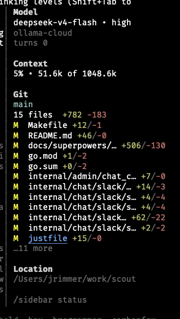

# pi-sidebar-sages

> **Fork of [jrimmer/pi-sidebar](https://github.com/jrimmer/pi-sidebar)** maintained for use with the [Sages](https://github.com/vanpipy/sages) orchestrator. The upstream package is the source of truth for the floating sidebar; this fork adds a task board panel and a bidirectional `sidebar_event` event channel. See [SAGES-FORK.md](./SAGES-FORK.md) for what diverges and why.
>
> **Vendored as a Sages sage peer at `sages/pi-sidebar/`.** This copy is
> the canonical one. The package is named `@sages/pi-sidebar` and
> `pi-orchestrator/scripts/install.sh` deploys it to
> `~/.pi/packages/pi-sidebar-sages` (the `-sages` suffix keeps it from
> colliding with an upstream `pi-sidebar` install, so both can coexist).
> The standalone repo at `~/Project/pi-sidebar-sages/` is the
> pre-vendoring reference.

Floating right sidebar for the [pi coding harness](https://pi.dev) with model, context, git, and session metadata.

`pi-sidebar` is an installable package for the pi coding harness. It renders a non-capturing right sidebar overlay, defaults to a vertically centered floating mode on the right side, and auto-hides while the LLM is working so it does not obscure review of in-progress model output. An optional full-height mode is available for a more fixed-window look.



> A true fixed sidebar that reserves space and reflows pi's transcript/editor/footer requires native Pi TUI window-region support. See [Future native Pi TUI window regions](docs/architecture/native-tui-window-future.md).

## Features

- **Floating sidebar by default** — right-anchored, non-capturing overlay positioned near the visual middle of the screen.
- **Optional full-height mode** — `/sidebar full` or `PI_SIDEBAR_FULL_HEIGHT=1` renders a fixed right window with a small gutter.
- **Auto-hide while the LLM is working** — hides on turn start and reappears when the turn ends. Disable with `PI_SIDEBAR_AUTOHIDE_WORKING=0`.
- **Compact model section** — shows model + reasoning level on one line, provider underneath.
- **Compact context usage** — shows percentage first, then used/available context, e.g. `13% • 1.5k of 200.0k`.
- **Git branch and diff summary** — shows current branch, changed file count, and total `+/-` stats.
- **Per-file git deltas** — changed-file rows preserve room for deltas and color additions/deletions separately.
- **Truncated git list** — changed-file rows are capped so the centered sidebar does not grow too tall; overflow renders as `…N more`.
- **Collapsible restore bar** — `/sidebar` or `ctrl+shift+s` shrinks the sidebar to a narrow right-edge bar and restores it; `/sidebar collapse` and `/sidebar expand` are also available.
- **Configurable git detail** — toggle longer/reduced changed-file lists with `/sidebar-git-detail`.
- **No footer replacement** — leaves pi's native footer alone.
- **Sages task board panel** — polls the orchestrator's `tasks/tasks.json` (or the in-workspace `.pi/tasks/*.json` session files) and renders intent / in_progress / completed / blocked counts plus a per-task glyph, subject, and status. Replaces the chat-polluting `sages-board-watch` pulse routine with passive sidebar awareness.
- **Reverse-channel task pick** — each row carries a `▶` affordance marker; pressing `ctrl+shift+t` picks the top task (in_progress first, then intent, then pending, then blocked) and injects `Sidebar: user selected task #N — <subject>` as a system note into the next LLM turn. The TUI's non-capturing overlay can't natively focus rows, so the keybinding is the bridge between the visual row and the orchestrator's read-side routing.
- **Responsive visibility** — auto-hides below a configurable terminal width.
- **Bidirectional `sidebar_event` channel** — Sages fork addition. The orchestrator (or any extension) emits structured events onto the sidebar; the LLM gets a `sidebar_event` tool it can call directly.

Example layout:

```text
Model
gpt-5.5 • medium
openai-codex
turns 4
last tool use bash

Context
5% • 49.2k of 1048.6k

Git
main
3 files  +507 -134
M  docs/superpowers/… +506/-130
M  go.mod +1/-2
M  go.sum +0/-2

Location
/path/to/project

/sidebar status
```

## Install

This package is a Sages sage peer, so it installs with the rest of the stack:

```bash
bash pi-orchestrator/scripts/install.sh
/reload
```

That deploys `pi-sidebar/` to `~/.pi/packages/pi-sidebar-sages` and registers it in `~/.pi/agent/settings.json`. `/reload` after install to pick the new copy up.

Standalone install still works, but it is no longer the canonical path:

```bash
# Local checkout (Sages fork)
pi install /home/leroy/Project/sages/pi-sidebar
# or, once published
# pi install git:github.com/vanpipy/pi-sidebar-sages
```

`pi remove git:github.com/jrimmer/pi-sidebar` first if the upstream package was previously present and you do NOT want both.

Install upstream for all pi coding harness instances on this computer:

```bash
pi install git:github.com/jrimmer/pi-sidebar
```

This repository also works with pi's raw GitHub URL install form:

```bash
pi install https://github.com/jrimmer/pi-sidebar
```

For local development from a checkout:

```bash
cd /path/to/pi-sidebar
pi install ./
```

Test for one run without installing:

```bash
pi -e git:github.com/jrimmer/pi-sidebar
```

For local development, make sure pi is loading this checkout, not the installed GitHub clone:

```bash
pi remove git:github.com/jrimmer/pi-sidebar
pi install /path/to/pi-sidebar
```

Then `/reload` re-reads the local files. If you keep the GitHub package installed, `/reload` only reloads pi's cloned copy under `~/.pi/agent/git/...`; it will not pick up uncommitted local checkout changes.

Reload an already-running pi after installation:

```text
/reload
```

Verify installation inside pi:

```text
/sidebar status
```

Manage the installed package:

```bash
pi list
pi update --extensions
pi remove git:github.com/jrimmer/pi-sidebar
```

Use project-local install only when you want `.pi/settings.json` in the current project to carry the dependency:

```bash
pi install -l git:github.com/jrimmer/pi-sidebar
```

> Note: local path installs reference this directory directly. Keep the directory around, or install from a git/npm source later.

## Commands

- `/sidebar` — collapse/expand the sidebar using the right-edge restore bar
- `/sidebar on` — show the expanded sidebar
- `/sidebar off` — hide the sidebar completely
- `/sidebar status` — show enabled/layout/autohide/git-detail/collapsed state
- `/sidebar full` — use full-height fixed-window sidebar mode
- `/sidebar floating` — use the default floating overlay window
- `/sidebar collapse` — collapse sidebar to the restore bar
- `/sidebar expand` — expand a collapsed sidebar
- `/sidebar-refresh` — refresh git/status data
- `/sidebar-git-detail` — toggle longer changed-file list
- `/sidebar-refresh-tasks` — force a poll of the Sages task board (the section normally refreshes on `PI_SIDEBAR_REFRESH_MS`)

Shortcut:

- `ctrl+shift+s` — collapse/expand the sidebar using the right-edge restore bar
- `ctrl+shift+t` — pick the top Sages task in the sidebar and inject a system note (`Sidebar: user selected task #N — <subject>`) into the next LLM turn. Selection priority: `in_progress` → `intent` → `pending` → `blocked`. Falls back to the first rendered row when no other status is present.

## Configuration

Set environment variables before starting pi:

| Variable | Default | Description |
| --- | ---: | --- |
| `PI_SIDEBAR_ENABLED` | `1` | Start enabled. Use `0` to start hidden. |
| `PI_SIDEBAR_WIDTH` | `34` | Sidebar content columns. |
| `PI_SIDEBAR_FULL_HEIGHT` | `0` | Use full-height fixed-window mode instead of floating mode. |
| `PI_SIDEBAR_BUFFER` | `1` | Blank gutter columns before the sidebar border in full-height mode. |
| `PI_SIDEBAR_FILL_ROWS` | `200` | Rows emitted to visually fill tall terminals in full-height mode. |
| `PI_SIDEBAR_VERTICAL_PADDING` | `1` | Blank rows added above and below the floating sidebar content. Use `0` to disable. |
| `PI_SIDEBAR_MIN_TERM_WIDTH` | `110` | Auto-hide below this terminal width. |
| `PI_SIDEBAR_OFFSET_Y` | `-6` | Floating-mode vertical offset. Negative moves up; `0` uses the TUI's exact `right-center` anchor. |
| `PI_SIDEBAR_AUTOHIDE_WORKING` | `1` | Hide while the LLM is working. |
| `PI_SIDEBAR_REFRESH_MS` | `5000` | Git polling interval. |
| `PI_SIDEBAR_GIT_LINES` | `12` | Max changed-file rows rendered in detailed mode; overflow shows `…N more`. |
| `PI_SIDEBAR_MAX_FILES` | `12` | Legacy alias used only when `PI_SIDEBAR_GIT_LINES` is unset. |
| `PI_SIDEBAR_GIT_DETAIL` | `1` | Start with detailed changed-file list. Reduced mode shows up to 5 rows. |
| `PI_SIDEBAR_TASKS` | `1` | Render the Sages task board section. Use `0` to hide the section entirely (also disables the polling loop). |
| `PI_SIDEBAR_TASKS_MAX` | `10` | Cap on visible task rows in the sidebar. Overflow renders as `…N more`. |

Example:

```bash
PI_SIDEBAR_WIDTH=40 PI_SIDEBAR_AUTOHIDE_WORKING=0 pi
```

## Git data

The sidebar uses pi's `pi.exec` helper to run static `git` commands in the current working directory:

- `git rev-parse --is-inside-work-tree`
- `git branch --show-current`
- `git diff --shortstat`
- `git status --porcelain=v1`
- `git diff --numstat HEAD --`

No shell strings are assembled from user input. The sidebar displays file paths and diff counts, not file contents.

## Tasks data

The Tasks panel reads the task store at one of three locations, in priority order:

1. `${ORCHESTRATOR_WORKDIR}/${projectKey(cwd)}/tasks/tasks.json` — Sages project scope (cross-session, shared).
   `ORCHESTRATOR_WORKDIR` defaults to `<tmpdir>/sages-orchestrator`; the orchestrator may override it. `projectKey(cwd)` mirrors the encoding `pi-tasks/src/task-paths.ts` uses.
2. `${cwd}/.pi/tasks/tasks-<sessionId>.json` — the current pi session's store.
3. `${cwd}/.pi/tasks/*.json` — every `tasks-*.json` under the workspace, merged and deduplicated by task id (later writes win).

If none exists the section shows `no tasks` muted rather than disappearing. Counts reported: intent / in_progress / completed / blocked (a `plan` task whose `blockedBy` references any non-completed task). Per-task rows are ordered by the store's on-disk order and capped at `PI_SIDEBAR_TASKS_MAX`. The `agentType` badge (e.g. `[Developer]`) appears for tasks whose metadata carries one. The poll interval reuses `PI_SIDEBAR_REFRESH_MS`.

## Sidebar event channel (Sages fork addition)

The fork registers a bidirectional channel between the orchestrator (or any other extension) and the LLM-facing tool surface. The LLM gets a `sidebar_event` tool; the sidebar listens on `pi.events` for matching emits. Other extensions can publish on the same channel without going through the tool.

### LLM tool

```
sidebar_event(
  action: "show" | "highlight" | "badge" | "toast" | "log" | "clear",
  target?: string,
  data?: object
) -> { emitted: true, event: "sidebar:event", ts: number }
```

Out-of-the-box actions:

- `show` / `highlight` — store `target` in `state.highlightedId` so a future sidebar section can render a transient highlight.
- `badge` — append a `{ ts, target, data }` entry to `state.badges`.
- `toast` — forward to `ctx.ui.notify(data.message, data.level)`; defaults to `"sidebar"` + `"info"` when `data` is empty.
- `log` — append `{ ts, target, data }` to `state.eventLog` (FIFO, capped at 50 entries).
- `clear` — reset `state.highlightedId` + `state.badges`; if `target` is provided, only strip that target's badge and clear the matching highlight.

Empty `data` and an absent `target` are both valid (the handler treats `undefined` as "use the default").

### Programmatic emit

Same channel, sidestepping the tool:

```ts
pi.events.emit("sidebar:event", {
  action: "badge",
  target: "task-42",
  data: { count: 3 },
  ts: Date.now(),
});
```

The handler registered by `registerSidebarEventTool` is the same code path regardless of how the event arrived, which means an orchestrator extension can fan-out to the sidebar without needing to know about the LLM tool surface.

## Docs

- [Design spec](docs/specs/2026-05-30-pi-sidebar-plugin-design.md)
- [Security/performance architecture review](docs/architecture/security-performance.md)
- [Future native Pi TUI window regions](docs/architecture/native-tui-window-future.md)

## Development

```bash
npm install --ignore-scripts
npm run verify
```

`npm run verify` runs TypeScript checks, unit tests, and `npm pack --dry-run` to confirm package contents.

### Adding a sidebar section

Sections are intentionally lightweight and local to this package. There is no nested Pi-package plugin system.

To add a section:

1. Add a self-contained renderer in `extensions/sidebar/sections/<name>.ts`.
2. Accept a `SidebarSectionContext` from `extensions/sidebar/types.ts`.
3. Register the renderer in the `SIDEBAR_SECTIONS` array in `extensions/sidebar.ts`.
4. Add or update tests in `tests/sidebar.test.ts`.

Existing examples: `model.ts`, `context.ts`, `git.ts`, `location.ts`, and `hint.ts`.

## Sages integration

The fork is one half of a two-package integration: the sidebar (this package, `sages/pi-sidebar/`) is the listener + visual surface, the Sages orchestrator (`sages/pi-orchestrator/`) is the emitter. The `pi.events.emit("sidebar:event", payload)` channel is the bridge. The fork registers `pi.events.on("sidebar:event", …)` inside `extensions/sidebar/sidebar-event-tool.ts` and routes every emit into the matching slice of `SidebarState` (`highlightedId`, `badges`, `eventLog`).

The Sages side fires 5 kinds of emit:

| When | Source | `action` | `target` | `data` |
|---|---|---|---|---|
| An intent is converted into plan tasks | `pi-orchestrator/src/orchestrator-tool.ts:1044` (`task_convert_intent`) | `highlight` | `intent-<id>` | `{ shape, phaseCount, planTaskIds }` |
| A plan task's subagent is spawned | `pi-tasks/src/index.ts:1434` (inside `TaskExecute`) | `highlight` | `task-<id>` | `{ agentType, subject, activeForm }` |
| A plan task completes | `pi-tasks/src/index.ts:361` (`subagents:completed` listener) | `log` | `task-<id>` | `{ status, durationMs, tokens }` |
| A Reviewer verdict is consumed | `pi-orchestrator/src/orchestrator-tool.ts:996` (`task_consume`, Reviewer-only) | `log` | `task-<id>` | `{ verdict, agentType }` |
| `eval_score` returns a score | `pi-evaluator/src/tools/eval-score.ts:230` | `log` | `evaluator` | `{ score, dimensions }` |

The full Sages-side walkthrough — entry points, top symbols, runtime flows, defensive design — is at `sages/pi/docs/learn/pi-sidebar-sages.md`. Cross-reference there for any change on the Sages side; cross-reference `extensions/sidebar/sidebar-event-tool.ts` (this package) for any change on the listener side.

> With the sidebar installed, the `sages-board-watch` 30s pulse routine becomes optional. The sidebar's Tasks panel polls `tasks/tasks.json` (or the in-workspace session files) on `PI_SIDEBAR_REFRESH_MS` and is the passive awareness surface; the routine's chat reminders only help sessions without the sidebar overlay.

## Current limitation

This plugin uses pi's supported overlay API. Floating mode is the default. Optional full-height mode renders a fixed right window plus gutter and covers the right edge of the transcript/footer. It approximates pushing content left visually, but true layout reservation/reflow still requires pi core support. See [Future native Pi TUI window regions](docs/architecture/native-tui-window-future.md) for the proposed core direction.
